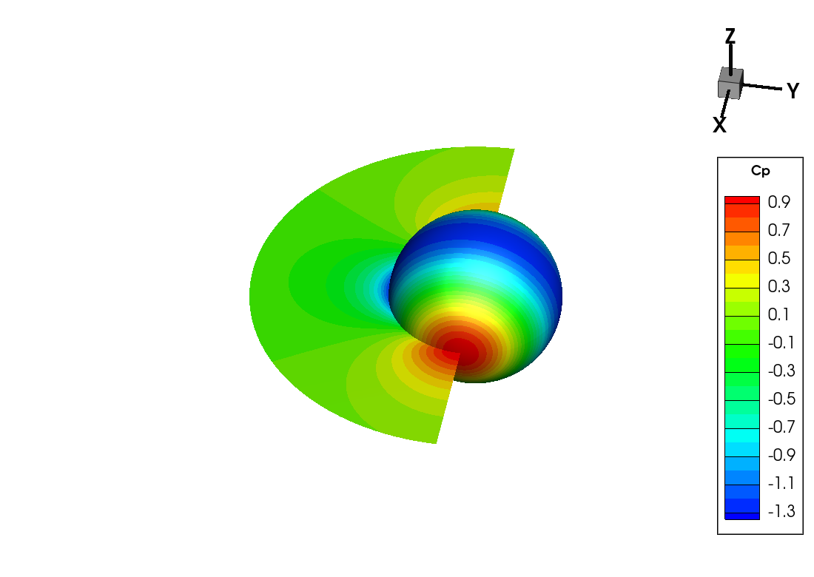
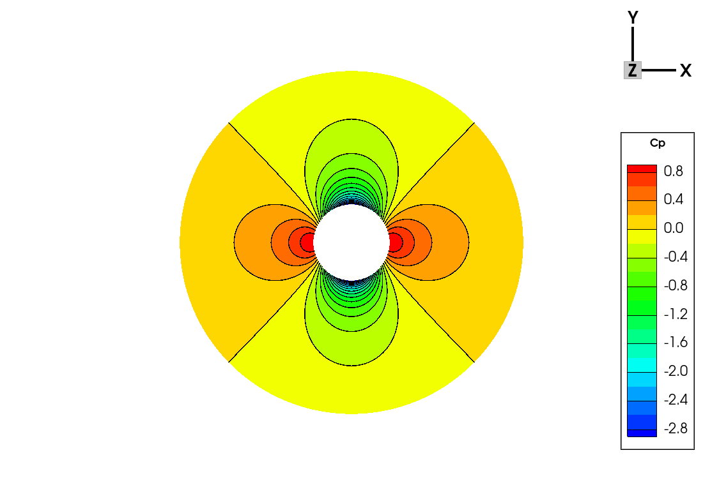
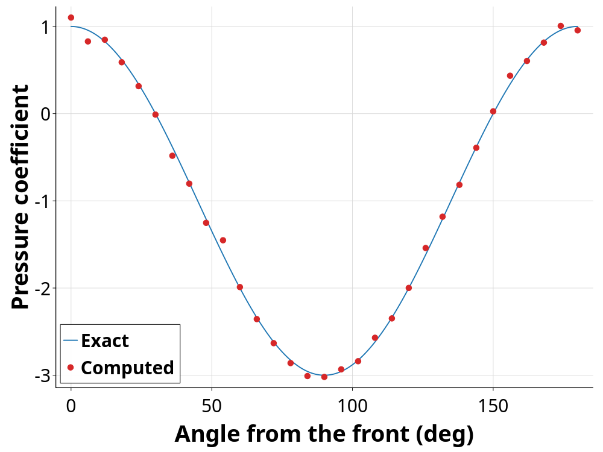

# FlowLens

FlowLens is a CFD post-processor for 3-D and 2-D field data and XY plots, with a Tecplot-style workflow.
It opens the common solver and mesh formats, draws contours, slices, iso-surfaces and streamtraces, plots curves of any
variable against any other, and imports Tecplot layouts.

This repository holds the downloads. Get the latest from the [Releases](../../releases/latest) page.



| Contours on a 2-D field | XY Line plot |
|---|---|
|  |  |

## Install

### Linux (x86_64)

1. Download `flowlens-<version>-linux-x86_64.tar.gz`.
2. Unpack it anywhere and run it:

   ```bash
   tar xzf flowlens-<version>-linux-x86_64.tar.gz
   ./flowlens/flowlens
   ```

It needs a desktop session with an OpenGL 3.2 driver and glibc 2.30 or newer (Ubuntu 20.04+, RHEL / Rocky / Alma 9+,
Debian 11+, Fedora, Arch). Nothing else needs to be installed.

### macOS (Apple silicon)

1. Download `FlowLens-<version>-macos-arm64.dmg`.
2. Open it and drag **FlowLens.app** to **Applications**.
3. The first time, right-click the app and choose **Open**. The app is not notarised, so a plain double-click can be blocked.

There is no build for Intel Macs.

## Open data

Start FlowLens and use **File → Open**, or pass files on the command line: `./flowlens/flowlens case.plt`.
A plain text file of columns (x y, CSV, TSV) opens as an XY Line plot.

## What it reads

| Family | Extensions |
|---|---|
| Tecplot | `.plt` (binary), `.dat` `.tec` (ASCII), layouts `.lay` |
| VTK | `.vtk` `.vtu` `.vtp` `.vts` `.vtr` `.vti` `.vtm` `.pvtu` |
| CGNS | `.cgns` |
| PLOT3D | `.x` `.xyz` `.grd` `.g` `.p3d` with `.q` `.f` `.fun` |
| Solver and mesh formats | OpenFOAM `.foam`, Fluent `.cas` `.msh` `.cas.h5`, Exodus II `.exo`, EnSight `.case`, UGRID, mStrand, FieldView `.fvuns` |
| Surface meshes | `.stl` `.obj` `.ply` `.facet` `.tri` `.x3d` |
| Plain text | `.txt` `.csv` `.tsv` `.xy`: columns of numbers, a solver's history file |

## If something does not work

- **macOS says the app cannot be opened or the developer cannot be verified:** right-click the app and choose **Open**,
  then confirm. Or run `xattr -dr com.apple.quarantine /Applications/FlowLens.app` once in a terminal.
- **Linux, the window does not appear:** start it from a terminal and read the messages. FlowLens needs a graphical
  session with working OpenGL. On a machine without a GPU driver, try `LIBGL_ALWAYS_SOFTWARE=1 ./flowlens/flowlens`.
- **Linux, a library is reported missing:** the package is meant to run without installing anything. Tell me which one,
  with your distribution and version.

## Questions and problems

Open an issue on this repository and say which version, which system, and what you did. If you can share a small
data file that shows the problem, that helps most.

## Licence

FlowLens is free to download and use, for any purpose including commercial and research work. You may modify it, look
inside it, and give copies to others free of charge. It may not be sold or rented. See [LICENSE.md](LICENSE.md) for the
terms, and [THIRD-PARTY-NOTICES.md](THIRD-PARTY-NOTICES.md) for the software that is included in it (Qt, VTK, NumPy,
SciPy ...).
